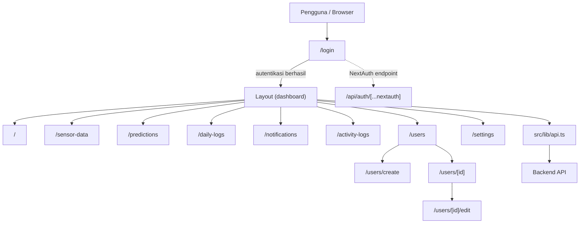

# Graph Struktur Folder dan Path

Diagram ini menggambarkan folder kode dan path halaman aplikasi. Folder hasil build (`.next`), dependensi (`node_modules`), dan metadata Git (`.git`) tidak diperluas.

## Graph folder

```mermaid
flowchart TD
    Project["smartfarmv3-dashboard/"]

    Project --> Public["public/"]
    Project --> Src["src/"]

    Src --> App["app/"]
    Src --> Components["components/"]
    Src --> Hooks["hooks/"]
    Src --> Lib["lib/"]
    Src --> Store["store/"]
    Src --> Types["types/"]
    Src --> Proxy["proxy.ts"]

    App --> DashboardGroup["(dashboard)/"]
    App --> Api["api/"]
    App --> Login["login/"]
    App --> AppLayout["layout.tsx"]
    App --> GlobalCss["globals.css"]
    App --> AppAssets["favicon.ico, smartfarmv2-logo.png"]

    DashboardGroup --> DashboardHome["page.tsx"]
    DashboardGroup --> DashboardLayout["layout.tsx"]
    DashboardGroup --> ActivityLogs["activity-logs/"]
    DashboardGroup --> DailyLogs["daily-logs/"]
    DashboardGroup --> Notifications["notifications/"]
    DashboardGroup --> Predictions["predictions/"]
    DashboardGroup --> SensorData["sensor-data/"]
    DashboardGroup --> Settings["settings/"]
    DashboardGroup --> Users["users/"]

    ActivityLogs --> ActivityLogsPage["page.tsx"]
    DailyLogs --> DailyLogsPage["page.tsx"]
    Notifications --> NotificationsPage["page.tsx"]
    Predictions --> PredictionsPage["page.tsx"]
    SensorData --> SensorDataPage["page.tsx"]
    Settings --> SettingsPage["page.tsx"]
    Users --> UsersPage["page.tsx"]
    Users --> UserCreate["create/page.tsx"]
    Users --> UserDetail["[id]/page.tsx"]
    Users --> UserEdit["[id]/edit/page.tsx"]

    Api --> AuthApi["auth/"]
    AuthApi --> NextAuthApi["[...nextauth]/route.ts"]
    Login --> LoginPage["page.tsx"]

    Components --> LayoutComponents["layout/"]
    Components --> Modals["modals/"]
    Components --> Providers["providers/"]
    Components --> Ui["ui/"]
    Components --> KandangSwitcher["KandangSwitcher.tsx"]
    Components --> NotificationProvider["notification-provider.tsx"]
    Components --> SessionExpired["session-expired-overlay.tsx"]

    Hooks --> UseApi["useApi.ts"]
    Hooks --> LiveSensor["useLiveSensorData.ts"]
    Hooks --> Tick["useTick.ts"]

    Lib --> ApiClient["api.ts"]
    Lib --> Auth["auth.ts"]
    Lib --> Utils["utils.ts"]

    Store --> KandangStore["useKandangStore.ts"]
    Types --> SharedTypes["index.ts"]
    Types --> NextAuthTypes["next-auth.d.ts"]

    LayoutComponents --> Navbar["navbar.tsx"]
    LayoutComponents --> Sidebar["sidebar.tsx"]
    Modals --> DailyLogModal["DailyLogModal.tsx"]
    Modals --> DeathReportModal["DeathReportModal.tsx"]
    Providers --> SessionProvider["session-provider.tsx"]
    Providers --> ThemeProvider["theme-provider.tsx"]
    Ui --> UiComponents["badge, button, card, input, modal, toast, tooltip"]
```

## Graph path halaman dan API

`(dashboard)` adalah route group Next.js: nama foldernya tidak menjadi bagian URL. Semua halaman dalam grup ini memakai layout dashboard.

## Folder proyek level teratas

- `src/`: kode aplikasi.
- `public/`: aset statis yang disajikan langsung.
- `.next/`: keluaran dan cache Next.js.
- `node_modules/`: dependensi JavaScript.
- `.git/`: metadata repository.

File konfigurasi dan dokumentasi berada langsung di root proyek, termasuk `package.json`, `tsconfig.json`, `next.config.js`, `eslint.config.mjs`, `vercel.json`, `README.md`, dan `DOKUMENTASI_NAVBAR_UI.md`.
